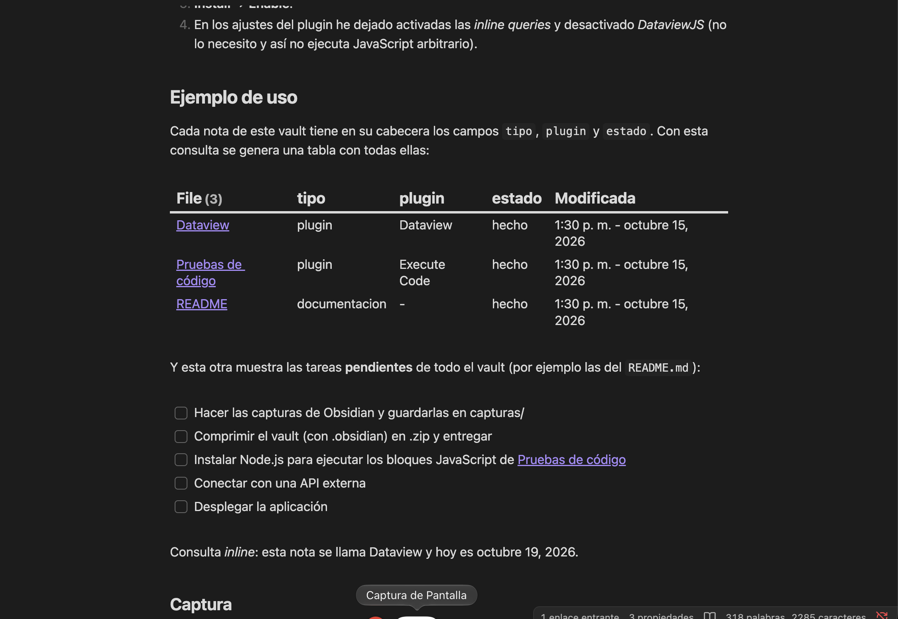

# Dataview

## Nombre y autor

| Campo | Valor |
|-------|-------|
| **Nombre** | Dataview |
| **Autor** | *Michael Brenan* (blacksmithgu) |
| **Versión instalada** | 0.5.68 |
| **Repositorio** | [github.com/blacksmithgu/obsidian-dataview](https://github.com/blacksmithgu/obsidian-dataview) |
| **Documentación** | [blacksmithgu.github.io/obsidian-dataview](https://blacksmithgu.github.io/obsidian-dataview/) |

## Qué hace y qué problema resuelve

**Dataview** convierte el vault en una pequeña *base de datos*. Lee los metadatos de las notas (el *frontmatter* YAML, etiquetas, fechas, tareas…) y permite hacer **consultas** parecidas a SQL para generar tablas, listas o listas de tareas que se actualizan solas.

Resuelve el problema de tener que mantener a mano índices o resúmenes: si añado una nota nueva con los metadatos adecuados, aparece automáticamente en las consultas.

## Instalación y configuración

1. *Settings* → **Community plugins** → desactivar *Restricted mode*.
2. Pulsar **Browse**, buscar `Dataview` y comprobar que el autor es *blacksmithgu*.
3. **Install** → **Enable**.
4. En los ajustes del plugin he dejado activadas las *inline queries* y desactivado *DataviewJS* (no lo necesito y así no ejecuta JavaScript arbitrario).

## Ejemplo de uso

Cada nota de este vault tiene en su cabecera los campos `tipo`, `plugin` y `estado`. Con esta consulta se genera una tabla con todas ellas:

```dataview
TABLE tipo, plugin, estado, file.mtime AS "Modificada"
FROM ""
WHERE tipo
SORT file.name ASC
```

Y esta otra muestra las tareas **pendientes** de todo el vault (por ejemplo las del `README.md`):

```dataview
TASK
WHERE !completed
```

Consulta *inline*: esta nota se llama `= this.file.name` y hoy es `= date(today)`.

### Captura



## Valoración

- **Mantenimiento:** es uno de los plugins más veteranos de la comunidad; sigue recibiendo versiones de corrección, aunque su autor está trabajando en *Datacore* como sucesor.
- **Descargas:** es de los plugins más descargados del catálogo (varios millones).
- **¿Lo recomendaría?** **Sí.** Es muy útil para organizar apuntes, llevar un control de tareas o hacer índices automáticos. La única pega es que hay que aprender su lenguaje de consultas.
