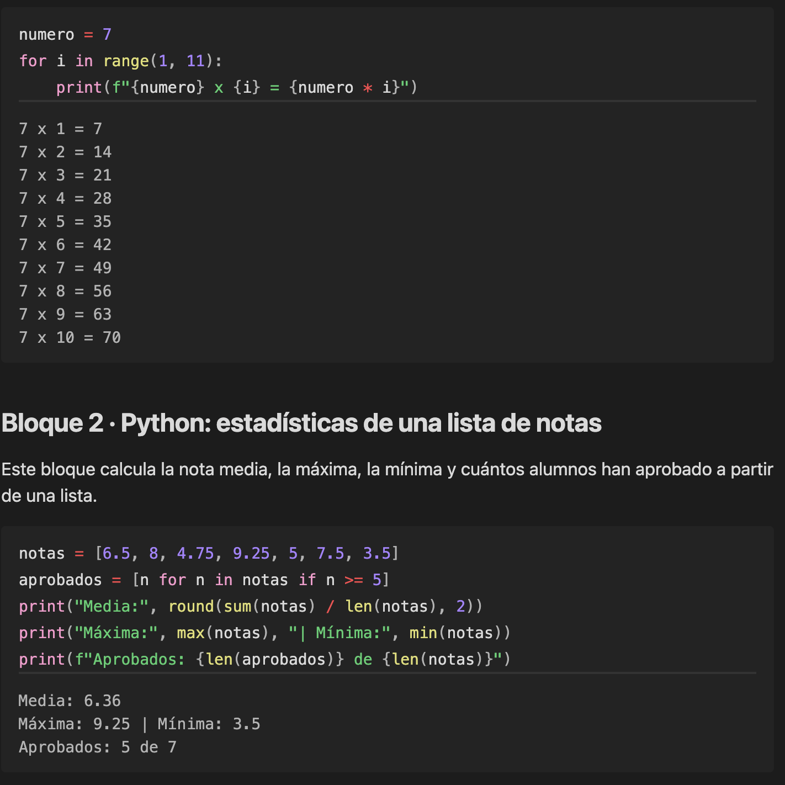
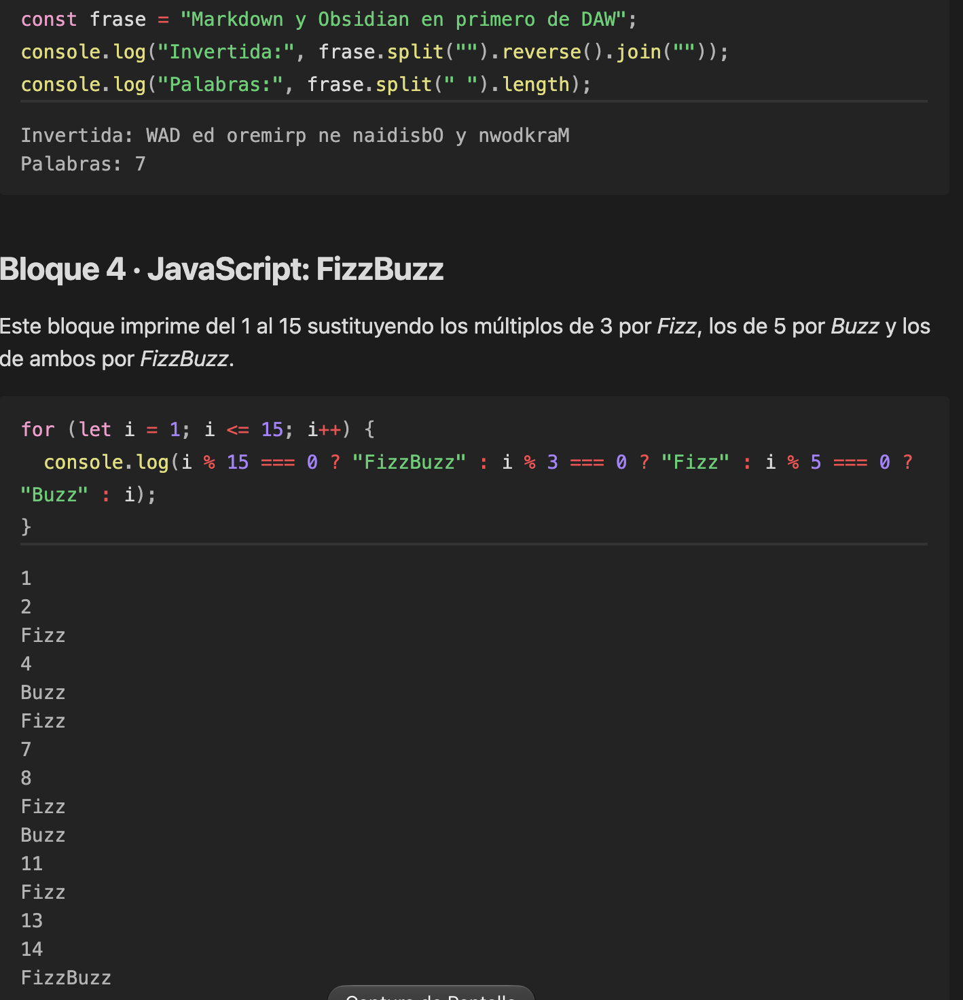

# Pruebas de código

Nota de prueba del plugin **Execute Code** (autor *twibiral*). Para ejecutar cada bloque, pasa a **modo lectura** y pulsa el botón **Run** que aparece debajo del bloque; la salida se muestra justo debajo.

## Bloque 1 · Python: tabla de multiplicar

Este bloque recorre los números del 1 al 10 con un bucle `for` y muestra la tabla de multiplicar del 7.

```python
numero = 7
for i in range(1, 11):
    print(f"{numero} x {i} = {numero * i}")
```

## Bloque 2 · Python: estadísticas de una lista de notas

Este bloque calcula la nota media, la máxima, la mínima y cuántos alumnos han aprobado a partir de una lista.

```python
notas = [6.5, 8, 4.75, 9.25, 5, 7.5, 3.5]
aprobados = [n for n in notas if n >= 5]
print("Media:", round(sum(notas) / len(notas), 2))
print("Máxima:", max(notas), "| Mínima:", min(notas))
print(f"Aprobados: {len(aprobados)} de {len(notas)}")
```

## Bloque 3 · JavaScript: invertir y contar palabras

Este bloque (ejecutado con Node.js) invierte una frase y cuenta cuántas palabras tiene.

```js
const frase = "Markdown y Obsidian en primero de DAW";
console.log("Invertida:", frase.split("").reverse().join(""));
console.log("Palabras:", frase.split(" ").length);
```

## Bloque 4 · JavaScript: FizzBuzz

Este bloque imprime del 1 al 15 sustituyendo los múltiplos de 3 por *Fizz*, los de 5 por *Buzz* y los de ambos por *FizzBuzz*.

```js
for (let i = 1; i <= 15; i++) {
  console.log(i % 15 === 0 ? "FizzBuzz" : i % 3 === 0 ? "Fizz" : i % 5 === 0 ? "Buzz" : i);
}
```

## Captura

Bloques de Python ejecutados en modo lectura, con su salida:



Bloques de JavaScript ejecutados con Node.js:


