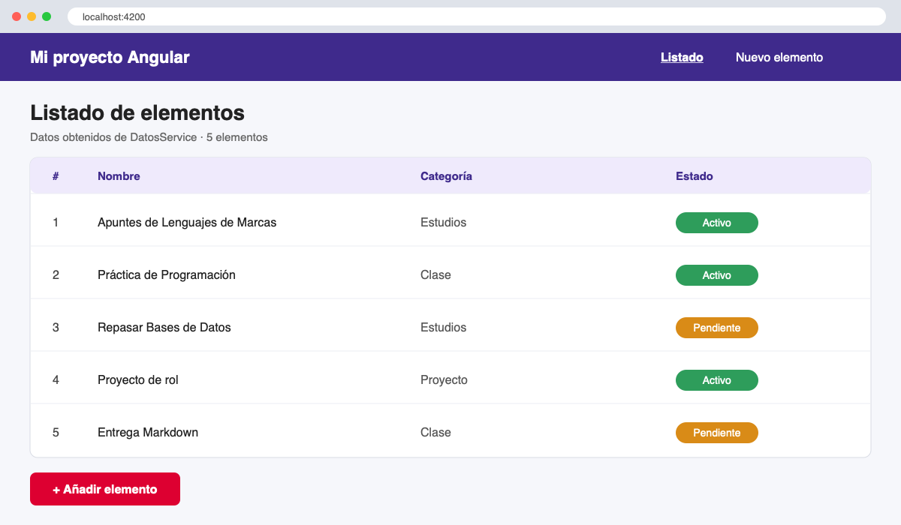
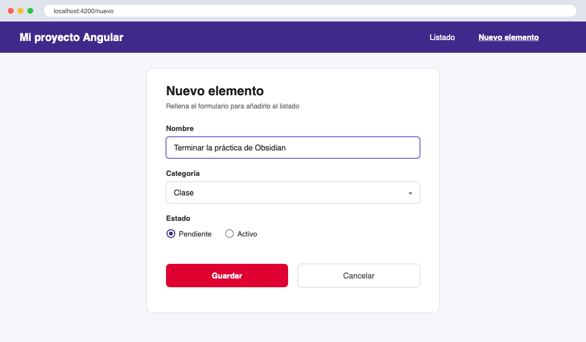
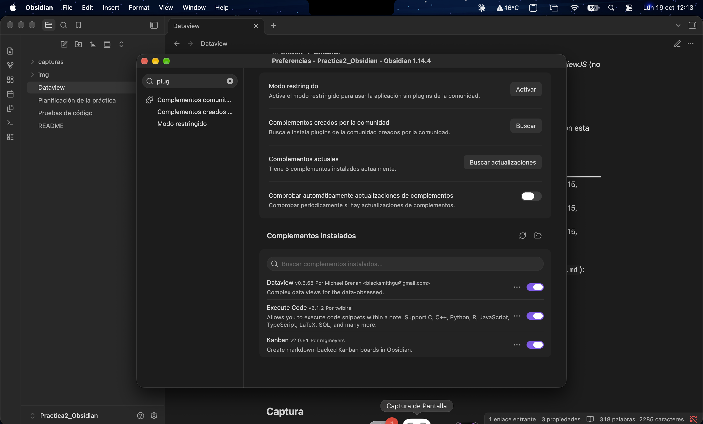
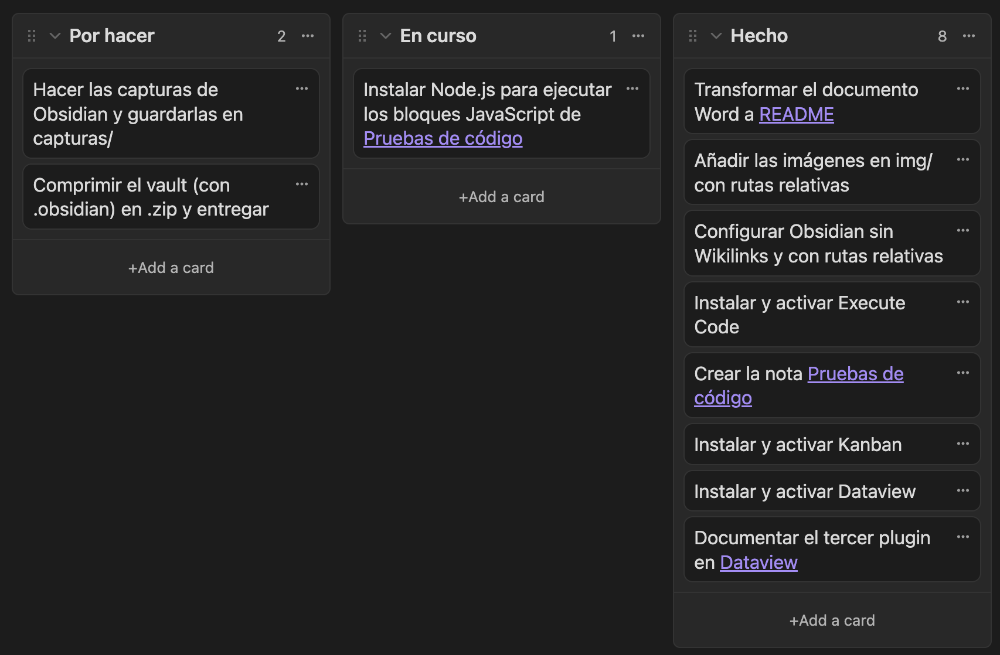

# Mi proyecto Angular


> [!note] Documento transformado de Word a **Markdown** para la *Práctica 2* de Lenguajes de Marcas (1º DAW).

## Índice

1. [Descripción](#descripción)
2. [Tecnologías utilizadas](#tecnologías-utilizadas)
3. [Instalación y puesta en marcha](#instalación-y-puesta-en-marcha)
4. [Estructura del proyecto](#estructura-del-proyecto)
5. [Componentes principales](#componentes-principales)
6. [Funcionalidades](#funcionalidades)
7. [Capturas](#capturas)
8. [Parte 2 · Obsidian y plugins](#parte-2--obsidian-y-plugins)
9. [Recursos](#recursos)

## Descripción

Este proyecto consiste en una aplicación web de una sola página (*SPA*) desarrollada con **Angular**. La aplicación permite al usuario navegar entre varias vistas, mostrar datos en forma de listado y gestionarlos mediante formularios.

El objetivo principal del trabajo fue aprender la **arquitectura basada en componentes** de Angular, el uso de *servicios* para compartir datos y el sistema de *enrutado* para moverse entre páginas sin recargar el navegador.

## Tecnologías utilizadas

| Tecnología        | Versión | Uso en el proyecto                |
| ----------------- | :-----: | --------------------------------- |
| **Angular**       |   18    | Framework principal (*frontend*)  |
| **TypeScript**    |   5.x   | Lenguaje de programación          |
| **HTML5**         |    —    | Plantillas de los componentes     |
| **CSS3**          |    —    | Estilos de la aplicación          |
| **Node.js / npm** |   20+   | Entorno y gestor de paquetes      |
| **Angular CLI**   |   18    | Creación y ejecución del proyecto |

## Instalación y puesta en marcha

Para ejecutar el proyecto en local hay que tener instalado **Node.js** y la *Angular CLI*:

```bash
npm install -g @angular/cli
ng new mi-proyecto
cd mi-proyecto
npm install
ng serve -o
```

Una vez arrancado, la aplicación queda disponible en `http://localhost:4200`. Para generar la versión de producción se usa `ng build`.

## Estructura del proyecto

```text
mi-proyecto/
├── src/
│   ├── app/
│   │   ├── components/
│   │   │   ├── header/
│   │   │   ├── lista/
│   │   │   └── formulario/
│   │   ├── services/
│   │   │   └── datos.service.ts
│   │   ├── app.component.ts
│   │   └── app.routes.ts
│   ├── index.html
│   └── styles.css
├── angular.json
└── package.json
```

## Componentes principales

| Componente | Descripción |
|------------|-------------|
| `HeaderComponent` | Barra de navegación con los enlaces a cada sección |
| `ListaComponent` | Muestra los elementos obtenidos del servicio |
| `FormularioComponent` | Permite añadir nuevos elementos |
| `DatosService` | Servicio que guarda y comparte los datos entre componentes |

Ejemplo de un componente *standalone* del proyecto:

```typescript
import { Component, inject } from '@angular/core';
import { NgFor } from '@angular/common';
import { DatosService } from '../../services/datos.service';

@Component({
  selector: 'app-lista',
  standalone: true,
  imports: [NgFor],
  templateUrl: './lista.component.html',
  styleUrl: './lista.component.css'
})
export class ListaComponent {
  private datos = inject(DatosService);
  elementos = this.datos.getElementos();
}
```

Y su plantilla HTML:

```html
<ul>
  <li *ngFor="let elemento of elementos">{{ elemento.nombre }}</li>
</ul>
```

Las rutas se definen en `app.routes.ts`:

```typescript
export const routes: Routes = [
  { path: '', component: ListaComponent },
  { path: 'nuevo', component: FormularioComponent },
  { path: '**', redirectTo: '' }
];
```

## Funcionalidades

- [x] Crear el proyecto con Angular CLI
- [x] Crear el componente de cabecera
- [x] Crear el componente de listado
- [x] Crear el servicio de datos
- [x] Configurar el enrutado entre vistas
- [x] Añadir formulario para nuevos elementos
- [ ] Conectar con una API externa
- [ ] Desplegar la aplicación

## Capturas





## Parte 2 · Obsidian y plugins

Este README forma parte de un *vault* de **Obsidian** al que se le han añadido tres plugins de la comunidad:

| Plugin | Autor | Nota del vault |
|--------|-------|----------------|
| **Execute Code** | *twibiral* | [Pruebas de código](Pruebas%20de%20código.md) |
| **Kanban** | *mgmeyers* | [Planificación de la práctica](Planificación%20de%20la%20práctica.md) |
| **Dataview** | *blacksmithgu* | [Dataview](Dataview.md) |

Los tres plugins activados en *Settings → Community plugins*:



Tablero *Kanban* con la planificación de la práctica:



## Recursos

- [Documentación oficial de Angular](https://angular.dev)
- [Angular CLI](https://angular.dev/tools/cli)
- [TypeScript](https://www.typescriptlang.org/docs/)
- [Guía de Markdown](https://www.markdownguide.org/basic-syntax/)

---

*Autor:* **Jesús** · 1º DAW
